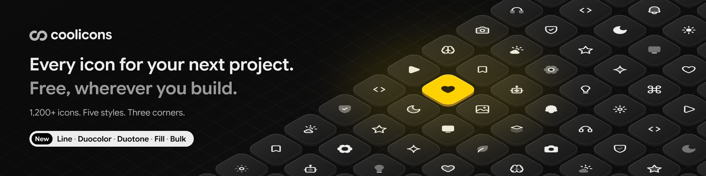

<p align="center">
  <a href="https://coolicons.cool">
    
  </a>
</p>

<p align="center">
  1,200+ free icons in five styles, with sharp, regular or round corners,<br>
  for React, Vue, shadcn/ui, SVG and Figma.
</p>

<p align="center">
  <a href="https://coolicons.cool/icons">Browse all icons</a> ·
  <a href="https://coolicons.cool/docs">Docs</a> ·
  <a href="https://www.figma.com/community/file/800815864899415771">Figma file</a> ·
  <a href="CHANGELOG.md">Changelog</a>
</p>

<p align="center">
  <a href="https://github.com/krystonschwarze/coolicons/stargazers"></a>
  <a href="https://www.figma.com/community/file/800815864899415771"></a>
  <a href="https://www.npmjs.com/package/@coolicons/react"></a>
  <a href="LICENSE"></a>
</p>

| 1,200+ | 5 | 3 | 18,000+ | 500k+ |
| :---: | :---: | :---: | :---: | :---: |
| icons in 30 categories | styles, Line to Bulk | corners, sharp to round | SVG files | Figma downloads |

## Why coolicons

**Icons that match your interface.** Each icon comes in Line, Duocolor, Duotone, Fill and Bulk, with sharp, regular or round corners. A rounded app gets round icons, a sharp dashboard gets sharp ones, and you can change your mind later without touching a single drawing.

**Sharp at 24 pixels.** The icons sit on a 24 by 24 grid with a 2 px stroke. Lines and corners land on whole pixels, so edges stay crisp at their native size.

**Where you work.** Find and adjust icons on [coolicons.cool](https://coolicons.cool), use the Figma file, or install the packages below. Coding agents get an MCP server, a CLI and a skill, so they look names up instead of guessing.

## Made by

Hey, I’m [Kryston](https://krystonschwarze.com), a design engineer from Germany. I started coolicons in 2018, when there were only a few icon sets and most of them were small. Since then the Figma file has been downloaded more than 500,000 times. For coolicons v5 I redrew the whole set from scratch.

[Website](https://krystonschwarze.com) · [LinkedIn](https://www.linkedin.com/in/kryston-schwarze-1b4789180/) · [X](https://x.com/KrystonSchwarze)

## Figma

The [coolicons file on Figma Community](https://www.figma.com/community/file/800815864899415771) has the whole set as components, with style and corners as properties.

<!-- Check against the finished Community file before publishing. -->

<!-- Plugin: the generator adds "Get the plugin" with the Community link once FIGMA_PLUGIN_URL is set. -->

## Packages

| Package | |
| --- | --- |
| [`@coolicons/react`](packages/react) | React components |
| [`@coolicons/vue`](packages/vue) | Vue 3 components |
| [`@coolicons/svg`](packages/svg) | SVG files and a manifest for everything else |
| [`@coolicons/cli`](packages/cli) | Search and copy icons from the terminal |
| [`@coolicons/mcp`](packages/mcp) | MCP server for coding agents |

## React

```sh
npm install @coolicons/react
```

```jsx
import { House } from "@coolicons/react";

export function Home() {
  return <House size={20} />;
}
```

## Vue

```sh
npm install @coolicons/vue
```

```vue
<script setup>
import { House } from "@coolicons/vue";
</script>

<template>
  <House :size="20" />
</template>
```

## SVG

```sh
npm install @coolicons/svg
```

Every icon is a file at `@coolicons/svg/<style>/<radius>/<name>.svg`, for example `@coolicons/svg/line/regular/house.svg`. `manifest.json` lists each icon with its category and a fingerprint per file. Each release on GitHub also has all files as a zip.

## Styles and radii

| Style | |
| --- | --- |
| `line` | Strokes |
| `duocolor` | Strokes with a lighter second stroke |
| `duotone` | Strokes over a light tone |
| `fill` | Solid shapes |
| `bulk` | Solid shapes over a light tone |

Each style comes with `sharp`, `regular` and `round` corners. The package root is Line with Regular corners. Every other combination has its own entry, and only the icons you import end up in your bundle:

```js
import { House } from "@coolicons/react";
import { Folder } from "@coolicons/react/fill";
import { Bell } from "@coolicons/react/bulk/round";
```

Icons use `currentColor` and take the text color around them.

## Props

| Prop | Default | |
| --- | --- | --- |
| `size` | `24` | Width and height in pixels or any CSS length |
| `strokeWidth` | `2` | Stroke width of Line, Duocolor and Duotone. Fill and Bulk have no strokes |
| `title` | | Adds a `<title>` and `role="img"`. Without a title the icon is hidden from screen readers |

All other attributes go to the `<svg>` element.

## Names

Names are lowercase English words joined by hyphens, like `file-plus-corner`. Components use the same words in PascalCase, like `FilePlusCorner`, and are also exported with an `Icon` suffix, like `FilePlusCornerIcon`. Both names always work.

Use the plain name unless JavaScript, the browser or a framework already uses it. `Map` is a JavaScript global, `File` a browser global and `Link` a component in Next.js and React Router. Importing an icon with such a name hides the original in that file, so `value instanceof File` quietly stops working. For these icons, use the suffix:

`ActivityIcon`, `BluetoothIcon`, `ClipboardIcon`, `CodeIcon`, `ComponentIcon`, `FileIcon`, `FontIcon`, `FunctionIcon`, `GamepadIcon`, `HistoryIcon`, `ImageIcon`, `InfinityIcon`, `KeyboardIcon`, `LabelIcon`, `LinkIcon`, `LockIcon`, `MapIcon`, `NavigationIcon`, `OptionIcon`, `PresentationIcon`, `RouteIcon`, `RouterIcon`, `SettingsIcon`, `ShareIcon`, `TextIcon`, `WindowIcon`

The list covers the globals of JavaScript, browsers, Node, Deno, Bun and React Native, and the exports of React, Next.js, React Router, TanStack Router, React Native, Expo Router, Vue, Vue Router, Solid, Svelte, Preact, Angular, Astro, Qwik, Lit, Inertia and Gatsby.

Some icons have a second name, like `reply` for `arrow-u-turn-up-left`. Both point to the same component.

## Icons by name

When the icon comes from data, like in a CMS or an icon picker, `CooliconsIcon` renders it by its name. It loads all icons of one style and radius on first use, about 60 KB gzipped for Line and 230 KB for Bulk.

```jsx
import { CooliconsIcon, icons } from "@coolicons/react/dynamic";

<CooliconsIcon name="house" variant="fill" radius="round" />
```

`icons` lists every name with its category, `preload(variant, radius)` loads a style ahead of time.

## Coding agents

Agents do not know coolicons names from their training data. Three tools let them look names up instead of guessing:

| | |
| --- | --- |
| [`@coolicons/mcp`](packages/mcp) | MCP server with search, SVG source and imports: `claude mcp add coolicons -- npx -y @coolicons/mcp` |
| [`@coolicons/cli`](packages/cli) | Search and copy icons from the terminal: `npx @coolicons/cli search delete` |
| [Skill](skills/coolicons) | Teaches agents the packages and naming rules: `npx skills add krystonschwarze/coolicons` |

All three work offline, the whole set ships with them.

## Versions

All packages share one version. From 5.0.0 on, a major version removes or renames icons, a minor version adds icons and a patch redraws icons or changes categories. A renamed icon keeps its old name until the next major version.

## Brand icons

The brand icons show logos of other companies. The trademarks belong to their owners. The MIT license covers the drawing, not the trademark. If you use a logo, follow the brand guidelines of its owner.

## License

MIT © [Kryston Schwarze](https://krystonschwarze.com)
